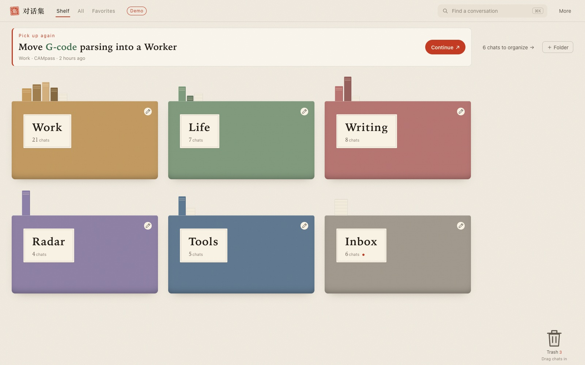
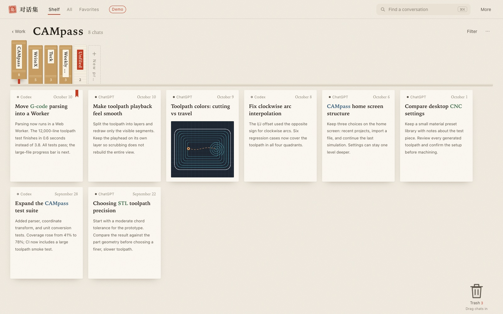
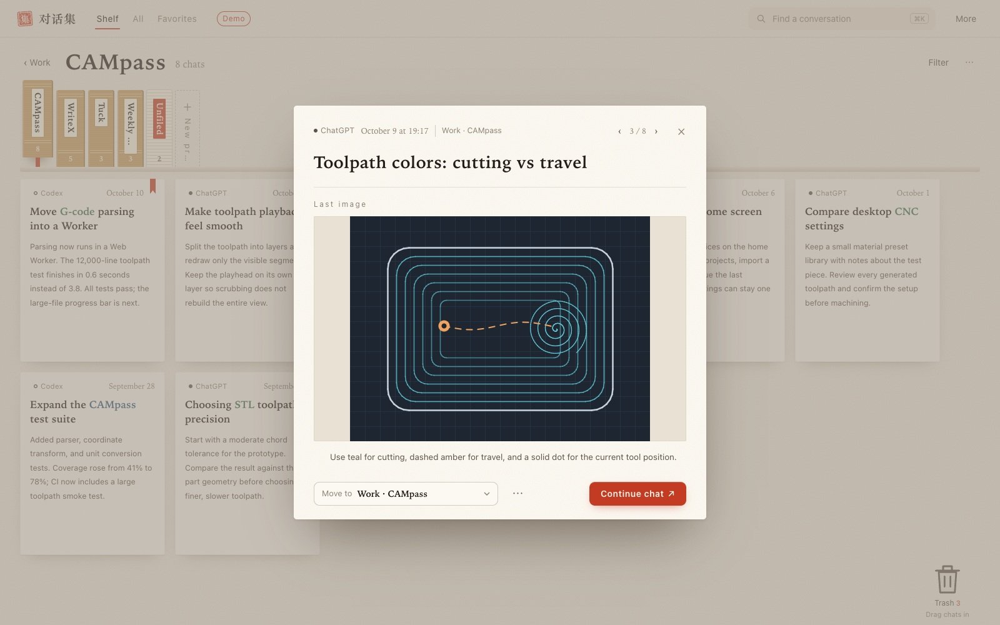
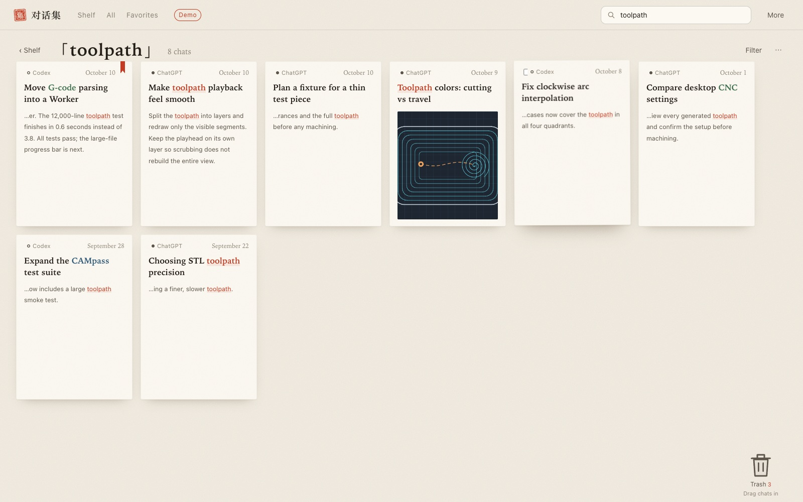
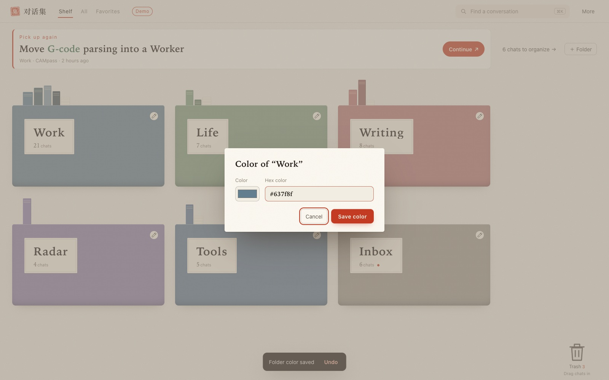
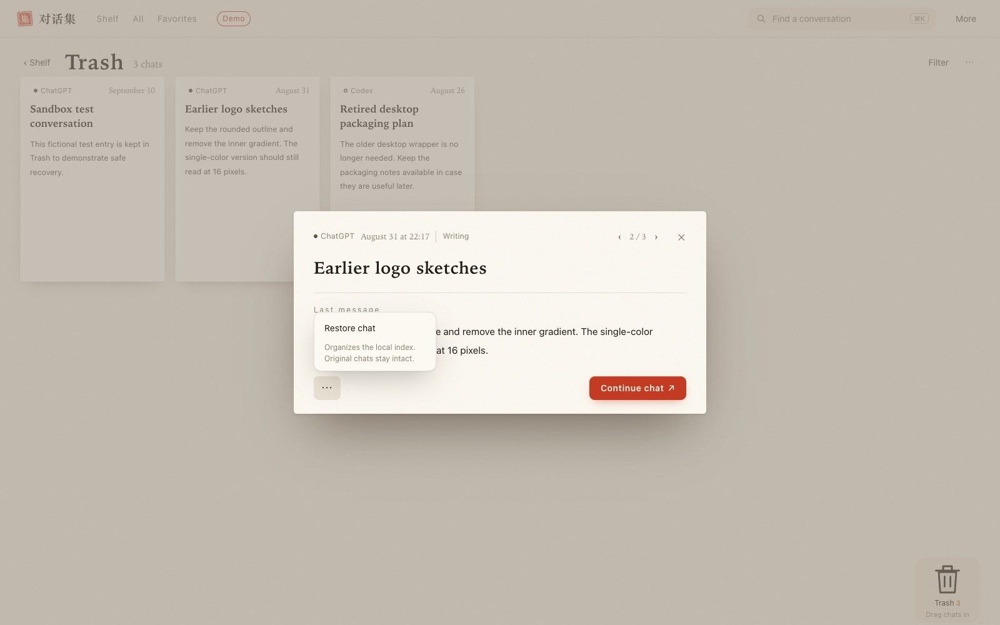

# ChatShelf · 对话集

**Find the conversation. Pick up the project.**

A free Codex desktop plugin that collects your AI conversations into a project bookshelf. Keep related ChatGPT and Codex chats together, recognize the right one from its preview, and continue supported Codex chats in the desktop client.

**English** · [简体中文](README.zh-CN.md)

macOS + Codex with plugin support · Free · MIT · By **pakco** · **0.9.6-beta.2**

## 30-second quick start

Already have the Codex desktop app installed and signed in? Start here:

1. **[Download the complete macOS package](https://github.com/pakco77/chat-shelf/releases/download/v0.9.6-beta.2/chat-shelf-0.9.6-beta.2-macos.zip).** It includes the plugin's dependencies.
2. **Unzip, keep the folder, double-click `Install.command`.** Wait for the installation-complete message.
3. **Start a new Codex chat and send:**

   > Open ChatShelf (对话集) and import the chat titles currently visible to your tools.

Your imported chats appear in **Inbox**. Open one and choose **Move to** to file it under a project.

This is a three-step quick-start guide; download and first-import time vary with your connection and client. Use the complete ZIP above, not GitHub's automatic “Source code” download. [Detailed setup & troubleshooting →](INSTALL.md)

[Download / release notes](https://github.com/pakco77/chat-shelf/releases/tag/v0.9.6-beta.2) · [Watch the 15-second demo](https://github.com/pakco77/chat-shelf/releases/download/v0.9.6-beta.2/chat-shelf-demo-15s.mp4) · [Report an issue](https://github.com/pakco77/chat-shelf/issues)

## Your next step, right at the top

The home shelf gives you a clear place to resume: your most recently updated chat, its project, and a **Continue** button. The colored folders keep the rest of your work within reach.



*Actual interface, fictional demo data. “Pick up again” currently uses the most recently updated chat, rather than a cross-client reading history.*

## Keep one project together

A plan in ChatGPT and its implementation in Codex can belong to the same project. Sources stay visible on the cards. Choose the project spine to focus on the conversations for that piece of work.



**The payoff:** return to a project with its related conversations already collected in one place.

## Recognize the conversation before opening it

Open a card to see its imported last-message excerpt or image. Move it into a project from that same preview; the red stamp confirms where you filed it. For supported macOS Codex chats, **Continue** hands the conversation to the native desktop client.



**The payoff:** use the preview to decide whether this is the conversation you wanted, then file it without losing your place. Previews require imported content; title-only records never invent a summary.

## Search the words you remember

Press **⌘K** and search titles and imported last-message excerpts. Matching words are highlighted so you can scan the results and recognize the right conversation.



**The payoff:** find a useful fragment even when you do not remember the exact title. Search covers the local index and imported previews, not every message in your account.

## Make the shelf yours

Choose your own folder colors and drag folders into the order that suits your work. Names, colors, order, and project assignments stay in your local data and backups.



**The payoff:** give your active work a familiar place on the shelf. Folder ordering also supports **Option + arrow keys**.

## Tidy up with a way back

Drag a card—or a selection of cards—onto the large Trash target. Open Trash to restore them, or use Undo immediately. Archiving and Trash organize the local index; original platform conversations stay intact.



**The payoff:** keep the shelf focused and recover a conversation when you need it again.

## See the flow in 15 seconds

[](https://github.com/pakco77/chat-shelf/releases/download/v0.9.6-beta.2/chat-shelf-demo-15s.mp4)

The silent, 1080p demo shows project selection, preview, filing, and the Continue entry using fictional data. The demo video has Chinese interface text; the screenshots above show the English interface. Demo records do not open real conversations.

## What this beta supports

| Capability | Current support |
| --- | --- |
| Projects, folders, favorites, search, colors and ordering | Available |
| Local archive, Trash, restore, Undo, backup and recovery | Available |
| Collect visible titles through the current Codex chat | Available when the host provides chat-list tools; not full-history collection |
| Import ChatGPT `conversations.json`, an index JSON, or a ChatShelf backup | Available |
| Last-message and image previews | Available when corresponding content has been imported |
| Continue a macOS Codex chat in the native client | Native dispatch verified; the client controls access and loading |
| Background automatic sync and native ChatGPT navigation | Not connected in this beta |
| Windows, Linux and Claude | Not verified in this release |

A successful handoff means the system accepted the native-open request. It does not confirm that the client subsequently loaded the original chat. A deleted record, a different account, or an unavailable device may still prevent opening it.

The interface follows the host's Chinese or English locale; other locales currently fall back to English. Product names and your own chat, folder, and project names keep their original text. The current index supports up to 5,000 chats. Saved entries do not expire simply because they are old.

## Collect your own conversations

The plugin starts empty. Ask Codex to collect titles visible to its current tools, or use **More → Import chats** and drop in your own JSON file. If chat-list tools are unavailable, file import remains available.

To add previews, explicitly ask Codex to retrieve the last visible message for the conversations you choose. Only actual returned content is used; a search summary is not substituted for a last-message preview. Refreshing titles preserves your existing organization and previews.

## Free, local, and open source

ChatShelf has no plugin subscription, requires no model API key, and includes no developer telemetry. The host application's account requirements and charges are separate.

Your index, organization, previews, and backups are stored by default in `~/Library/Application Support/ChatShelf/`. Asking Codex to collect or inspect records brings those records into the host's tool workflow; this is not a claim of entirely offline processing. [Read the data and privacy note →](PRIVACY.md)

Update by installing a new complete package; your local data is preserved. Save a backup first and open a new Codex chat after installation. Uninstall or disable the plugin through the client's plugin settings; the data folder is retained for recovery.

## For contributors

Source installs need macOS, Node.js 18+ (a supported LTS is recommended), npm, and Codex with plugin support:

```sh
git clone https://github.com/pakco77/chat-shelf.git
cd chat-shelf
npm ci --ignore-scripts
zsh Install.command
```

Checks: `npm run check` and `npm run check:install`. The install check uses temporary user and plugin directories. Run `npm start` for the local interface at `127.0.0.1:4317`. See [INSTALL.md](INSTALL.md) for setup and recovery.

Found a problem? [Open an issue](https://github.com/pakco77/chat-shelf/issues) with your macOS, client and plugin versions plus the steps to reproduce it. Keep private chat exports, backups and connection files out of public reports.

[MIT License](LICENSE) · Copyright © 2026 pakco. Distributed through this repository; not listed in the official plugin directory.
