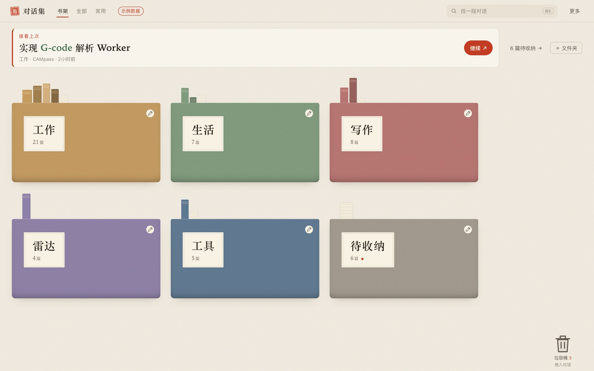
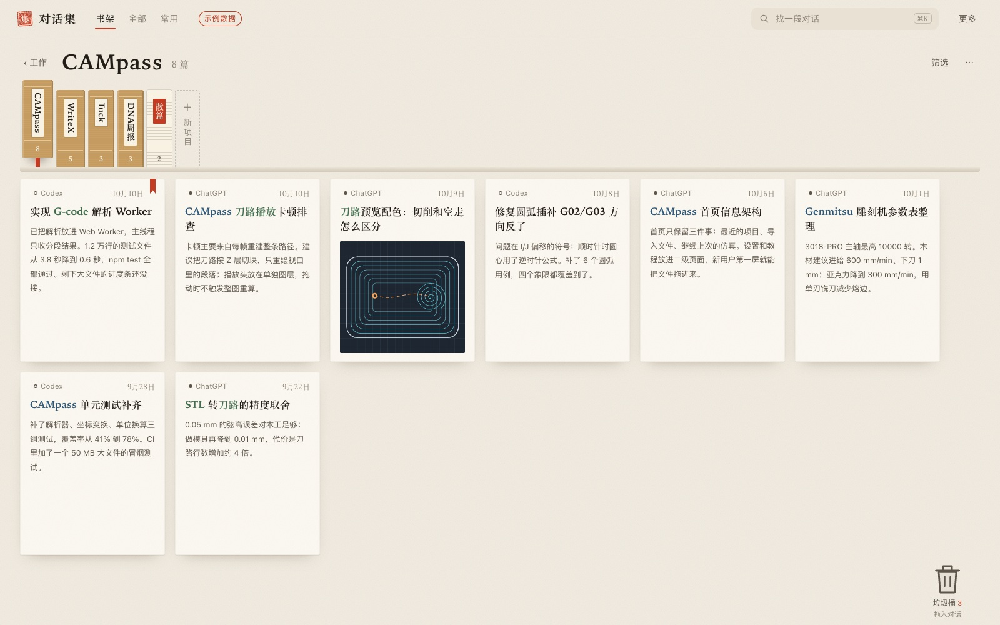
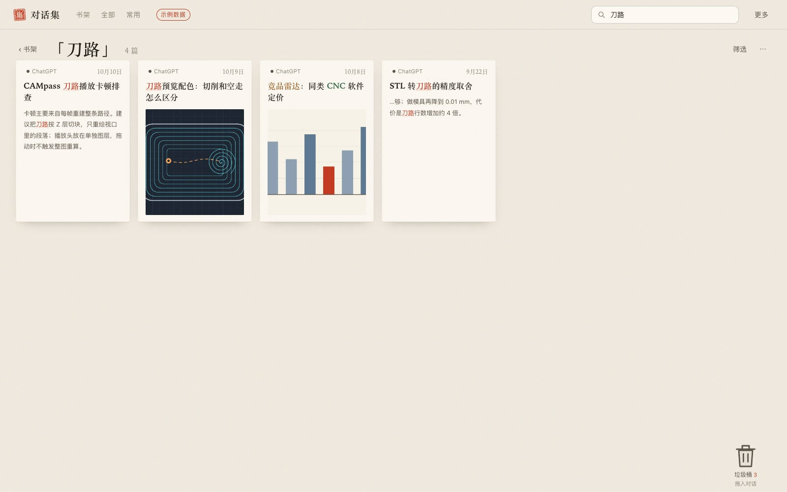
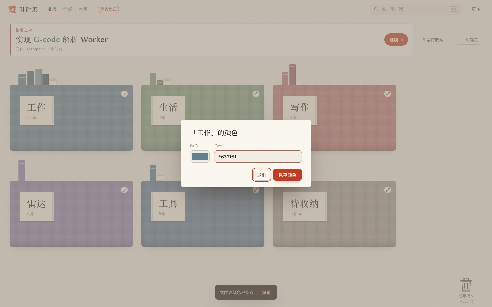
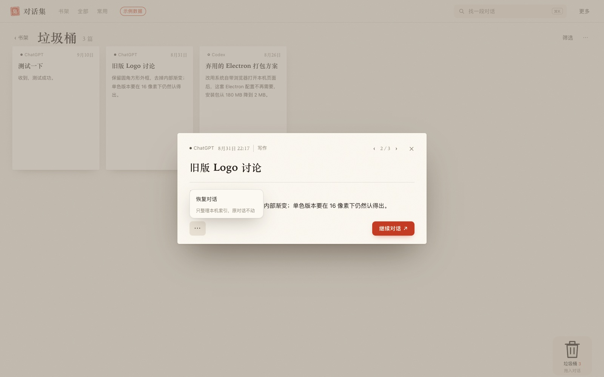
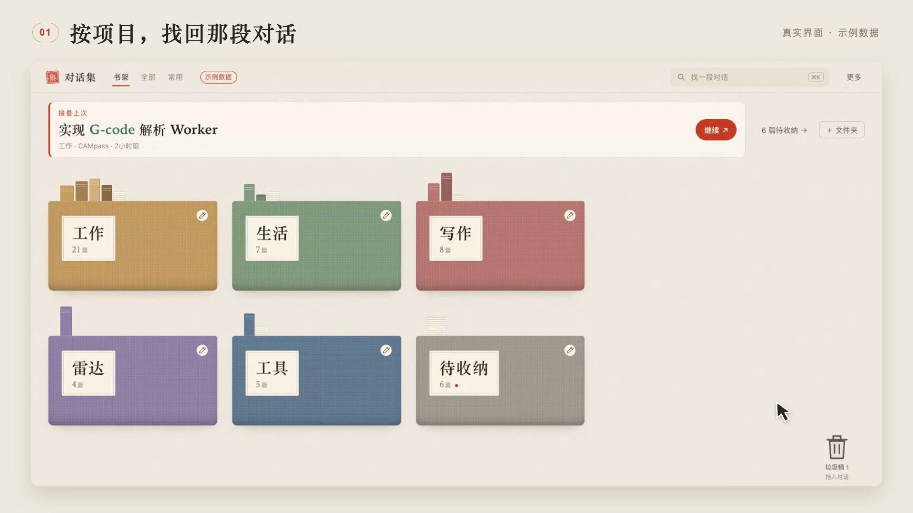

# 对话集 · ChatShelf

**把对话收好，把工作接上。**

一个免费的 Codex 桌面插件，把散落的 AI 对话按项目收成一本本集子。ChatGPT 里的方案和 Codex 里的实现放在一起，通过预览认出要找的那一段，再回到支持的 Codex 原对话继续。

[English](README.md) · **简体中文**

macOS + 支持插件的 Codex · 免费 · MIT 开源 · 开发者 **pakco** · **0.9.6-beta.2**

## 30 秒快速启用

已经安装并登录 Codex 桌面客户端？按这三步开始：

1. **[下载 macOS 完整安装包](https://github.com/pakco77/chat-shelf/releases/download/v0.9.6-beta.2/chat-shelf-0.9.6-beta.2-macos.zip)**，包内已包含插件运行依赖。
2. **解压并保留整个文件夹，双击 `Install.command`**，等待出现“安装完成”。
3. **在 Codex 新建一个对话，发送：**

   > 打开对话集，把当前可见的聊天标题收录进去

收录后的对话会出现在「待收纳」。打开一篇，选择「归入」，就能放进项目。

这是三步快速说明；下载与首次收录的实际耗时取决于网络和客户端。请下载上面的完整 ZIP，不要选 GitHub 自动生成的 `Source code` 源码包。[详细安装与常见问题 →](INSTALL.zh-CN.md)

[下载与版本说明](https://github.com/pakco77/chat-shelf/releases/tag/v0.9.6-beta.2) · [观看 15 秒演示](https://github.com/pakco77/chat-shelf/releases/download/v0.9.6-beta.2/chat-shelf-demo-15s.mp4) · [反馈问题](https://github.com/pakco77/chat-shelf/issues)

## 打开就知道，接下来做什么

首页把最近更新的对话、所属项目和「继续」按钮放在最前面。下面的彩色文件夹，收好其他正在进行的事。



*真实界面，虚构示例数据。「接着上次」当前取最近更新的一篇，并非跨客户端的最后阅读记录。*

## 同一个项目，放在同一本集子里

ChatGPT 里讨论方案，Codex 里写实现，都能归入同一个项目。来源仍标在卡片上；点一下项目书脊，就只看这件事相关的对话。



**带来的变化：** 回到一个项目时，相关对话已经聚在一起。

## 先认出来，再继续

点开卡片，可以查看已导入的末段文字或图片。直接在预览里归入项目，朱红印章会确认收到了哪一本集子里。支持的 macOS Codex 对话，点击「继续对话」就交给桌面客户端打开。


**带来的变化：** 先看内容判断是不是要找的那一篇，顺手归入，预览保持打开。预览需要导入对应内容；只有标题时不会编造摘要。

## 记得几个词，也能找回来

按 **⌘K**，搜索标题和已导入的末段。命中词会高亮，扫一眼结果，就更容易认出想找的那一段。



**带来的变化：** 不必记住完整标题。搜索范围是本机索引和已导入预览，不是账户里的所有聊天正文。

## 按自己的习惯，摆好书架

给文件夹选择自定义颜色，直接拖动调整顺序。名称、颜色、顺序和项目归属都会保存在本机，并随备份带走。



**带来的变化：** 把常做的事放在熟悉的位置。键盘也能用 **Option + 方向键** 调整文件夹顺序。

## 收拾干净，也留一条退路

把一篇或多选的几篇卡片拖进大垃圾桶；需要时点开恢复，也能立即撤销。归档与垃圾桶整理的是本机索引，原平台上的聊天保持原状。



**带来的变化：** 书架只留眼前要做的事，之后还可以把对话找回来。

## 15 秒看完整流程

[](https://github.com/pakco77/chat-shelf/releases/download/v0.9.6-beta.2/chat-shelf-demo-15s.mp4)

1080p 无声短片，用虚构数据展示选项目、看预览、归入和继续入口。视频使用中文界面，上方截图也有完整英文版。示例对话不连接真实原文。

## 本次测试范围

| 能力 | 当前状态 |
| --- | --- |
| 项目、文件夹、常用、搜索、自定义颜色与排序 | 可使用 |
| 本机归档、垃圾桶、恢复、撤销与备份恢复 | 可使用 |
| 通过当前 Codex 对话收录可见标题 | 宿主提供列表工具时可使用；不是全量历史收录 |
| 导入 ChatGPT `conversations.json`、索引 JSON 或对话集备份 | 可使用 |
| 末段与末图预览 | 需要已导入对应内容 |
| 在原生客户端继续 macOS Codex 对话 | 已验证原生打开请求；访问权与实际加载由客户端处理 |
| 后台自动同步与 ChatGPT 原生定位 | 本测试版尚未接通 |
| Windows、Linux、Claude | 本次未验证 |

“已交给客户端”代表系统接受了原生打开请求，不代表客户端随后一定加载成功。原记录被删除、属于其他账户或设备不可用时，仍可能无法打开。

界面跟随宿主的中文或英文语言；其他语言暂回退英文。产品名以及用户自己的标题、文件夹名和项目名保持原文。当前单个索引最多 5,000 篇；已收录的记录不会仅因时间久而过期。

## 收录自己的对话

插件从空索引开始。让 Codex 收录当前工具可见的标题，或在「更多 → 导入对话」中选择自己的 JSON 文件，也可直接拖入。宿主没有列表工具时，仍可使用文件导入。

需要预览时，明确请 Codex 为选定对话补齐最后可见消息。只使用实际返回的内容，不把搜索摘要冒充末段。刷新标题会保留已有的整理状态和预览。

## 免费，本机保存，开源

对话集无需插件订阅、无需模型 API Key，也不收集开发者遥测。宿主客户端的账户要求与费用另计。

默认数据目录为 `~/Library/Application Support/ChatShelf/`，保存索引、整理状态、预览和备份。请 Codex 收录或读取记录时，内容会进入宿主工具处理流程，不等同于完全离线。[数据与隐私说明 →](PRIVACY.zh-CN.md)

更新时安装新版完整包，本机数据保留；建议先保存备份，安装后新建 Codex 对话。卸载或禁用在客户端插件设置中完成，数据目录保留以便恢复。

## 从源码安装与开发

需要 macOS、Node.js 18+（建议仍受支持的 LTS）、npm 和支持插件的 Codex：

```sh
git clone https://github.com/pakco77/chat-shelf.git
cd chat-shelf
npm ci --ignore-scripts
zsh Install.command
```

程序检查：`npm run check`、`npm run check:install`。安装检查使用临时用户和插件目录。运行 `npm start` 可在 `127.0.0.1:4317` 打开本机界面。安装与恢复详见 [INSTALL.zh-CN.md](INSTALL.zh-CN.md)。

遇到问题请在 [Issues](https://github.com/pakco77/chat-shelf/issues) 提供 macOS、客户端、插件版本及复现步骤。不要公开上传私人对话导出、备份或连接文件。

[MIT 许可证](LICENSE) · Copyright © 2026 pakco。通过本仓库分发，尚未上架官方插件目录。
